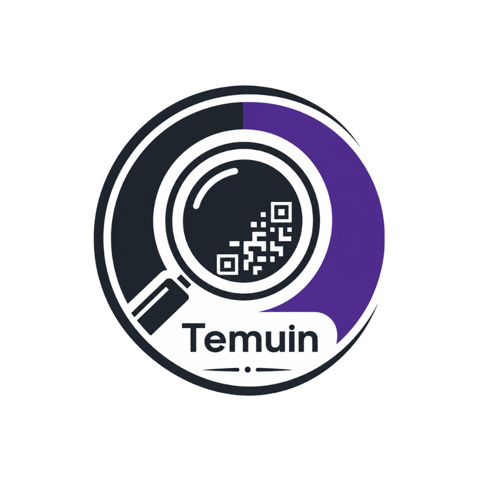
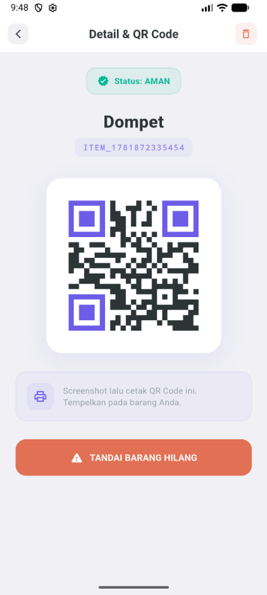
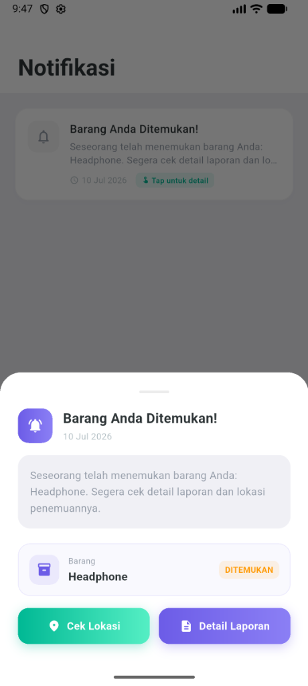

<div align="center">
  
  <h1>Temuin</h1>
  <p><strong>Lost and Found Platform Powered by Dynamic QR Code Identification & GPS Tracking</strong></p>

  [](https://flutter.dev)
  [](https://dart.dev)
  [](https://www.php.net)
  [](https://www.mysql.com)
  [](https://midtrans.com)
</div>

---

## About the Project

**Temuin** is a full-stack digital tracking and lost-and-found solution designed to help individuals secure, identify, and recover misplaced personal items (wallets, bags, keys, electronic devices, and academic credentials).

By attaching a unique physical **QR Code sticker** generated per registered item, any finder can instantly scan the tag with a smartphone camera, view privacy-sanitized contact information, and submit a discovery report complete with **real-time GPS coordinates** and photographic verification.

---

## Application Interface Previews

| Item Inventory & Anti-Lost QR Code Generator | Real-Time Recovery Notification & GPS Coordinates |
|:---:|:---:|
|  |  |

---

## Core Capabilities

### Mobile Client (Flutter)
- Item Registration & QR Generator: Register personal valuables and render high-resolution printable QR codes directly from the client.
- Integrated Camera Scanner: Fast and responsive QR code decoding via `mobile_scanner`.
- Real-Time GPS Incident Reporting: Finders submit recovery reports that automatically capture exact latitude and longitude coordinates alongside photographic evidence.
- Native Navigation Mapping: Integrated with external mapping providers (Google Maps) to direct the verified owner directly to the recovery location.
- Monetized Post Boosting (Midtrans Snap): Integrated micro-payments to elevate urgent lost item notices into featured priority listings.
- Item Slot Quota System: Every account receives an initial quota of 5 free slots, with optional bulk slot purchases processed via Midtrans Snap.
- Instant In-App Notifications: Item owners receive automated alert notifications the instant a discovery report is submitted.
- User Profile & Avatar Customization: Secure profile management and user identity management.

### Backend & Administration (PHP & MySQL)
- RESTful JSON API: Clean endpoint architecture handling authentication, item lifecycles, recovery claims, and alerts.
- Robust Token Security: Stateless Bearer token authorization backed by salted `BCRYPT` password hashing.
- Automated Payment Webhook: Secure callback listener verifying SHA-512 signatures from Midtrans to transition payment states (`settlement`, `pending`, `cancel`).
- Web Administrative Dashboard: Web-based control center for inspecting registered users, circulating inventory, and audit trails.

---

## Technology Stack

| Component | Technology | Description |
|:---|:---|:---|
| **Mobile Client** | Flutter 3.x / Dart | Modern Material 3 UI framework, targeting Android and iOS |
| **State & Local Storage** | `shared_preferences` | Local persistence of auth tokens and session data |
| **Camera & QR Engine** | `mobile_scanner`, `qr_flutter` | Camera decoding engine and vector QR generation |
| **Location & Media** | `geolocator`, `image_picker` | Fine GPS coordinate tracking and media uploads |
| **Backend REST API** | PHP Native (PDO) | Lightweight API with prepared SQL statements |
| **Database** | MySQL / MariaDB | Relational database (`temuin_db`) |
| **Payment Gateway** | Midtrans Snap API | Integrated digital transactions (Virtual Accounts, QRIS, e-Wallets) |

---

## Project Structure

```
temuin/
├── android/                    # Android platform configuration
├── assets/                     # Application logos and visual branding
├── backend/                    # PHP backend services
│   ├── admin/                  # Administrative web panel (auth, inventory, reports)
│   ├── api/                    # RESTful endpoints
│   │   ├── auth/               # Login, registration, and profile endpoints
│   │   ├── config/             # Database and payment credentials
│   │   ├── items/              # Item CRUD and boost operations
│   │   ├── notifications/      # User notification dispatchers
│   │   ├── payment/            # Midtrans charge requests and webhook listeners
│   │   ├── reports/            # Discovery and lost item reports
│   │   ├── uploads/            # Uploaded media storage
│   │   └── utils/              # Token verification and helper routines
│   └── database/
│       └── schema.sql          # SQL relational schema and initial seeds
├── docs/
│   └── screenshots/            # Interface preview assets
├── ios/                        # iOS platform configuration
├── lib/                        # Flutter application codebase
│   ├── core/                   # API constants, themes, and HTTP client
│   ├── screens/                # UI screens (auth, home, items, reports, scanner)
│   ├── utils/                  # Map launcher and session utilities
│   ├── widgets/                # Reusable UI component library
│   └── main.dart               # Main client application entry point
├── pubspec.yaml                # Flutter package dependencies
└── README.md                   # Technical documentation
```

---

## Setup and Installation

### 1. Prerequisites
- Flutter SDK (3.x or higher)
- PHP (>= 8.0) with extensions: `pdo_mysql`, `curl`, `json`
- MySQL / MariaDB Server
- Android Studio or Visual Studio Code with Flutter extensions

---

### 2. Database and Backend Configuration

1. Launch your MySQL server instance.
2. Import the schema file to construct the database and seed tables:
   ```bash
   mysql -u root -p < backend/database/schema.sql
   ```

3. Configure Payment Credentials:
   Duplicate the template configuration inside `backend/api/config/`:
   ```bash
   cp backend/api/config/midtrans.php.example backend/api/config/midtrans.php
   ```
   Add your Midtrans Sandbox Server Key:
   ```php
   $serverKey = 'Mid-server-YOUR_SERVER_KEY_HERE';
   $isProduction = false;
   ```

4. Verify Database Credentials:
   Update database connection parameters inside `backend/api/config/database.php` as needed.

---

### 3. Mobile Client Configuration

1. Install Dependencies:
   ```bash
   flutter pub get
   ```

2. Configure Endpoint Base URL:
   Open `lib/core/constants/api_constants.dart` and specify your backend host:
   ```dart
   // For Android Emulator
   static const String baseUrl = 'http://10.0.2.2/temuin/backend/api';

   // For Physical Devices via LAN or Tunneling
   static const String baseUrl = 'https://your-public-url.ngrok-free.dev/temuin/backend/api';
   ```

3. Run the Mobile Application:
   ```bash
   flutter run
   ```

---

## Author

Anak Agung Ngurah Krisna Artha Wibawa ([ANTARTICA1](https://github.com/ANTARTICA1))

## License

This project is open-source and licensed under the MIT License.