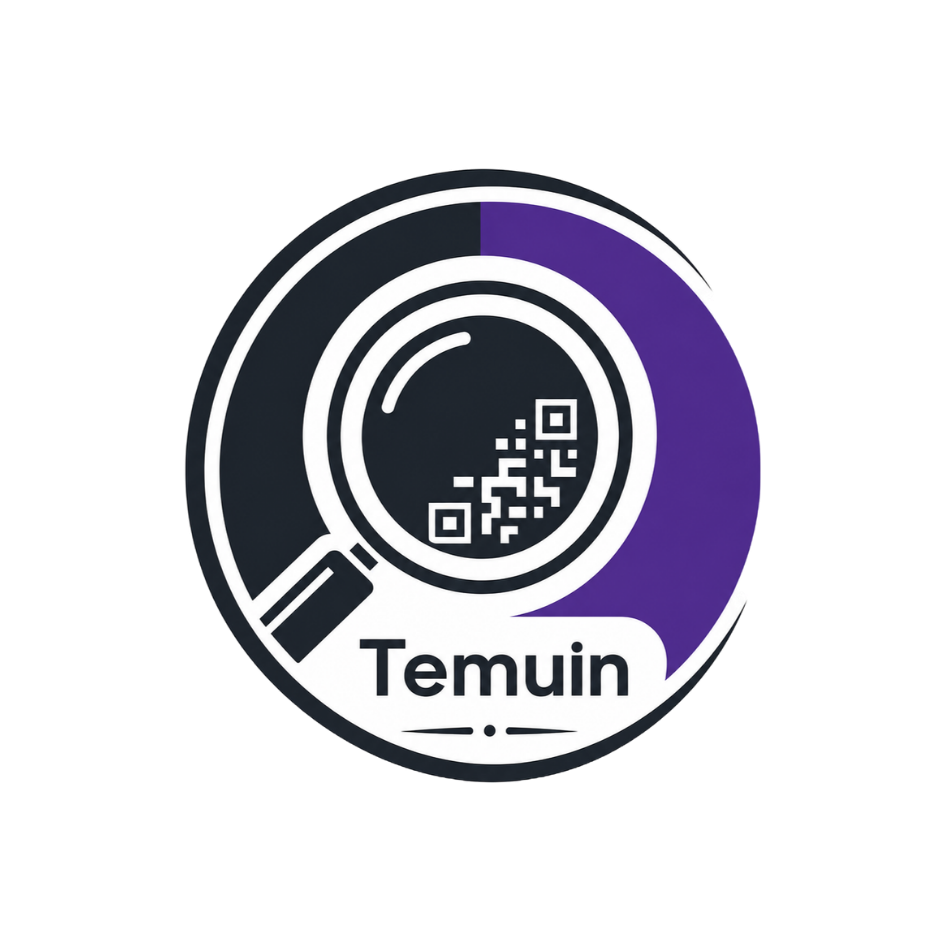

<div align="center">
  
  <h1>Temuin</h1>
  <p><strong>Aplikasi Pelacak & Penemu Barang Hilang Berbasis QR Code & GPS Tracking</strong></p>

  [](https://flutter.dev)
  [](https://dart.dev)
  [](https://www.php.net)
  [](https://www.mysql.com)
  [](https://midtrans.com)
</div>

---

## Tentang Project

**Temuin** adalah solusi komprehensif untuk membantu masyarakat mengamankan, melacak, dan menemukan barang-barang berharga yang hilang (seperti dompet, tas, kunci, gadget, atau dokumen). 

Dengan menempelkan stiker **QR Code** yang digenerate khusus untuk setiap barang, siapa saja yang menemukan barang tersebut dapat langsung memindai (*scan*) QR code, mengetahui informasi pemilik yang aman, dan mengirimkan laporan penemuan lengkap dengan **koordinat GPS lokasi terkini** dan foto bukti.

---

## Fitur Utama

### Aplikasi Mobile (Flutter)
* **Registrasi Barang & Generator QR Code**: Daftarkan barang pribadi dan cetak/simpan QR code unik secara langsung dari aplikasi.
* **Scanner QR Code Terintegrasi**: Pemindaian cepat dan responsif menggunakan kamera bawaan ponsel via `mobile_scanner`.
* **Laporan Temuan dengan GPS Real-time**: Penemu dapat mengirimkan laporan penemuan yang otomatis mencatat koordinat lintang & bujur (Latitude/Longitude) serta foto bukti.
* **Buka Lokasi di Peta**: Terintegrasi langsung dengan aplikasi navigasi (Google Maps) untuk mempermudah pemilik mendatangi lokasi penemuan barang.
* **Boost Postingan Hilang (Monetisasi & Prioritas)**: Fitur pembayaran menggunakan **Midtrans Snap** (Rp 15.000) untuk menaikkan postingan kehilangan ke bagian teratas (*Featured/Premium*).
* **Sistem Kuota Slot Barang (0/5 Gratis & Slot Tambahan Rp 9.000)**: Setiap pengguna mendapatkan kuota dasar 5 barang gratis (0/5). Untuk menambah barang ke-6 dan seterusnya, pengguna dapat membeli slot tambahan seharga **Rp 9.000 per slot** secara borongan/sekaligus melalui pembayaran **Midtrans Snap**.
* **Notifikasi Instan**: Pemilik barang langsung mendapatkan notifikasi dalam aplikasi saat barangnya dilaporkan ditemukan.
* **Manajemen Profil & Avatar**: Pengaturan identitas pengguna dan unggah foto profil.

### Backend & Admin Dashboard (PHP & MySQL)
* **RESTful JSON API**: Arsitektur endpoint bersih untuk autentikasi, manajemen barang, laporan, dan notifikasi.
* **Keamanan Autentikasi**: Autentikasi berbasis token Bearer dengan enkripsi password `BCRYPT`.
* **Midtrans Webhook Integration**: Penanganan callback otomatis dari gateway pembayaran Midtrans untuk update status transaksi (`settlement`, `pending`, `cancel`).
* **Web Admin Panel**: Dashboard berbasis web untuk memantau data pengguna, daftar barang beredar, dan riwayat laporan penemuan/kehilangan.

---

## Tech Stack

| Komponen | Teknologi | Deskripsi |
| :--- | :--- | :--- |
| **Mobile Client** | Flutter 3.x / Dart | Framework UI modern Material 3, cross-platform Android & iOS |
| **State & Storage**| `shared_preferences` | Penyimpanan sesi login dan token lokal |
| **Kamera & QR** | `mobile_scanner`, `qr_flutter` | Engine scan kamera & pembuatan QR code dinamis |
| **Lokasi & Media** | `geolocator`, `image_picker` | GPS tracking akurat & pengambilan foto kamera/galeri |
| **Backend API** | PHP Native (PDO) | REST API ringan dengan koneksi database aman |
| **Database** | MySQL / MariaDB | Relational database (`temuin_db`) |
| **Payment Gateway**| Midtrans Snap API | Pembayaran digital (GoPay, QRIS, Virtual Account, dll.) |
| **Local Tunnel** | Ngrok / Laragon | Tunneling koneksi lokal untuk pengujian di perangkat fisik |

---

## Struktur Direktori

```text
temuin/
├── android/                    # Konfigurasi native Android
├── assets/                     # Logo dan aset grafis aplikasi
├── backend/                    # Backend server (PHP)
│   ├── admin/                  # Web admin dashboard (login, items, reports, users)
│   ├── api/                    # REST API endpoints
│   │   ├── auth/               # Endpoint login, register, profile
│   │   ├── config/             # Konfigurasi database & payment gateway
│   │   ├── items/              # Endpoint CRUD barang & boost
│   │   ├── notifications/      # Endpoint notifikasi pengguna
│   │   ├── payment/            # Endpoint Midtrans charge & webhook
│   │   ├── reports/            # Endpoint laporan kehilangan & penemuan
│   │   ├── uploads/            # Direktori file media yang diupload
│   │   └── utils/              # Helper autentikasi & token parser
│   └── database/
│       └── schema.sql          # Skema database MySQL & seed data awal
├── ios/                        # Konfigurasi native iOS
├── lib/                        # Source code Flutter
│   ├── core/                   # Konstanta (warna, URL API) & client HTTP
│   ├── screens/                # UI Screens (auth, home, items, reports, scanner)
│   ├── utils/                  # Map launcher, token manager
│   ├── widgets/                # Reusable UI widgets
│   └── main.dart               # Entry point aplikasi Flutter
├── pubspec.yaml                # Manajemen dependensi Flutter
└── README.md                   # Dokumentasi project
```

---

## Panduan Instalasi & Menjalankan

### 1. Prasyarat Sistem
* [Flutter SDK](https://docs.flutter.dev/get-started/install) (versi 3.x atau terbaru)
* [PHP](https://www.php.net/) (>= 8.0) dengan ekstensi `pdo_mysql`, `curl`, `json` aktif
* [MySQL / MariaDB](https://www.mysql.com/) (tersedia di Laragon atau XAMPP)
* Android Studio / VS Code dengan Flutter Extension
* (Opsional) Akun Sandbox [Midtrans](https://dashboard.sandbox.midtrans.com/)

---

### 2. Setup Database & Backend (PHP)

1. **Jalankan Apache & MySQL** di Laragon / XAMPP.
2. Buka **phpMyAdmin** atau GUI MySQL favorit Anda, lalu import file skema database:
   ```bash
   backend/database/schema.sql
   ```
   *(Skema ini otomatis membuat database `temuin_db`, seluruh tabel relasional, dan 1 akun admin default).*

3. **Konfigurasi Midtrans Server Key**:
   Salin file template konfigurasi di `backend/api/config/`:
   ```bash
   cp backend/api/config/midtrans.php.example backend/api/config/midtrans.php
   ```
   Buka `backend/api/config/midtrans.php` dan masukkan Server Key Midtrans Anda:
   ```php
   $serverKey = 'Mid-server-YOUR_SERVER_KEY_HERE';
   $isProduction = false;
   ```

4. **Konfigurasi Database** (Jika username/password MySQL lokal Anda bukan `root` tanpa password):
   Sesuaikan di [`backend/api/config/database.php`](backend/api/config/database.php).

---

### 3. Setup Aplikasi Mobile (Flutter)

1. **Install Dependensi Flutter**:
   Buka terminal di root project dan jalankan:
   ```bash
   flutter pub get
   ```

2. **Atur URL API Backend**:
   Buka file [`lib/core/constants/api_constants.dart`](lib/core/constants/api_constants.dart):
   * **Jika menggunakan Android Emulator**:
     ```dart
     static const String baseUrl = 'http://10.0.2.2/temuin/backend/api';
     ```
   * **Jika menggunakan Perangkat HP Fisik (via Ngrok)**:
     Jalankan tunnel Ngrok (port 80) dan pasang domain publik Anda:
     ```dart
     static const String baseUrl = 'https://your-ngrok-domain.ngrok-free.dev/temuin/backend/api';
     ```

3. **Jalankan Aplikasi**:
   Pastikan emulator atau perangkat fisik Android/iOS sudah terhubung, lalu jalankan:
   ```bash
   flutter run
   ```

---
